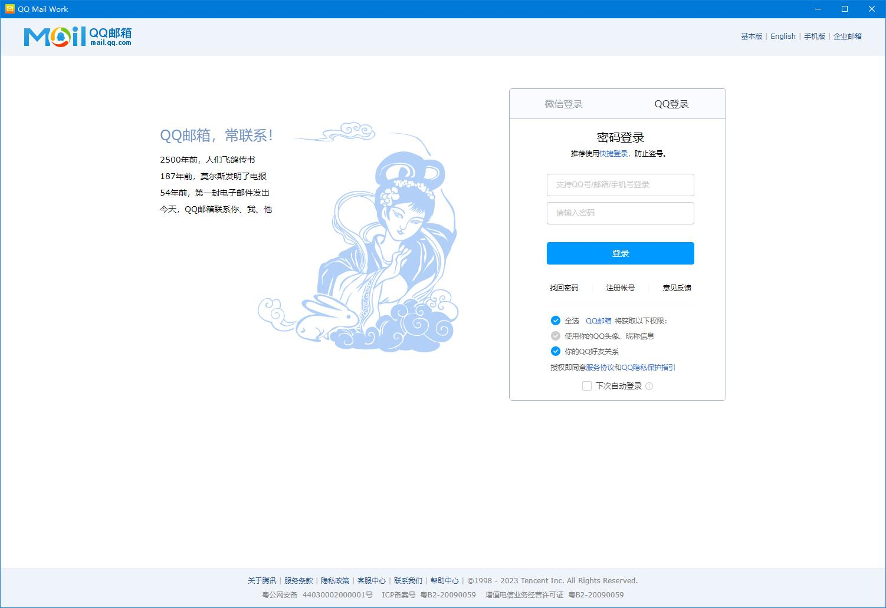
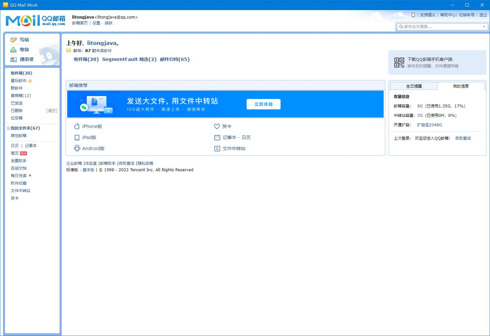

# tauri-qq-mail-work
使用rust语言的tarui框架将QQ Mail 网页版 封装为的QQ Mail 客户端GUI ,这个是工作版本  
The tarui framework of rust language is used to encapsulate the QQ Mail web version as the QQ Mail client GUI,this is work version




## 构建（Tauri v2）

需要 Rust 1.90 或更高版本；Windows 需要 MSVC C++ 构建工具和 WebView2 Runtime。

```sh
# 安装 Tauri v2 CLI（已有 v2 CLI 时无需重复安装）
cargo install tauri-cli --version "^2" --locked

# 开发运行
cargo tauri dev

# Release 构建并生成安装包
cargo tauri build

# 只编译 Release 可执行程序
cargo build --locked --release --features custom-protocol
```

可执行程序位于 `target/release/app.exe`，安装包位于 `target/release/bundle/`。
`cargo tauri build` 默认使用 Release；调试构建使用 `cargo tauri build --debug`。

本项目直接加载 `https://mail.qq.com/`，不需要本地 `dist` 目录。
Tauri v2 的 `devUrl` 和 `frontendDist` 均使用该地址，未为远程网页配置本地 API 权限。
